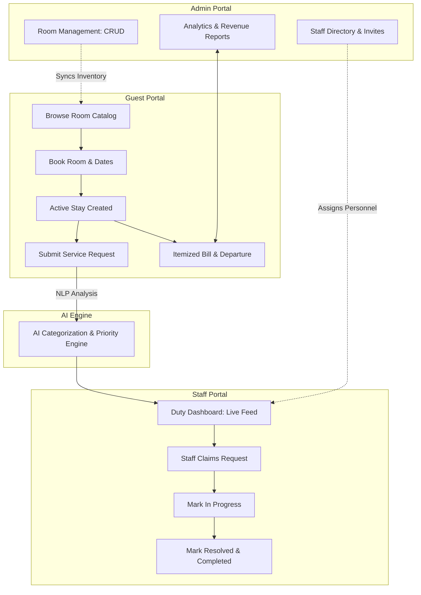
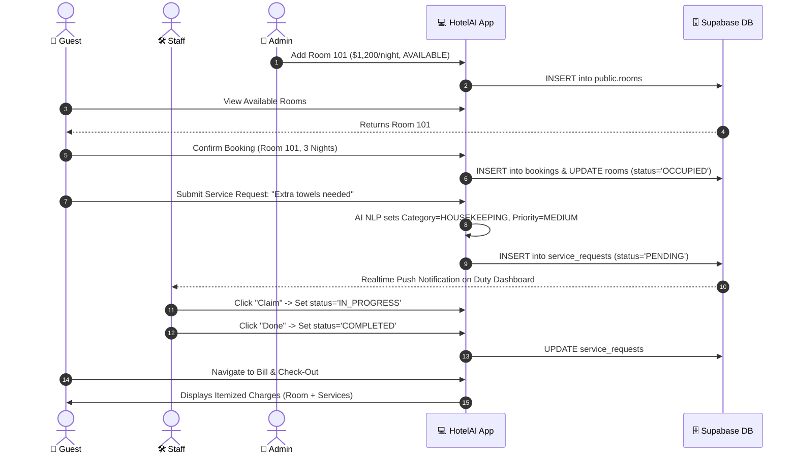
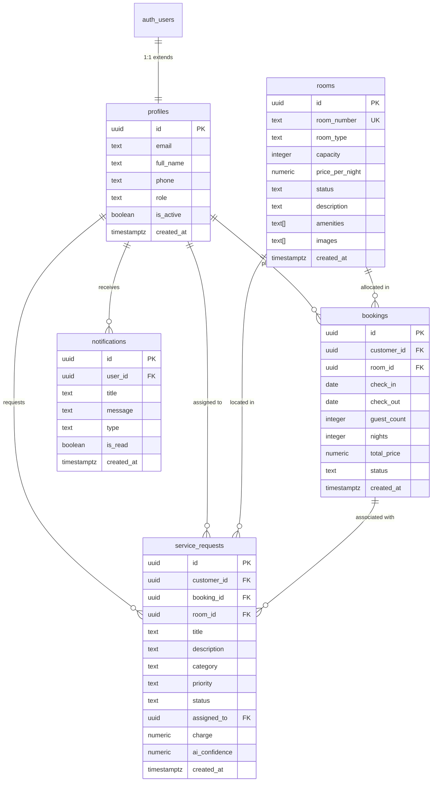

# 🏨 HotelAI — AI-Powered Hotel & Hostel Management System

[](https://vitejs.dev/)
[](https://react.dev/)
[](https://www.typescriptlang.org/)
[](https://supabase.com/)
[](https://reactrouter.com/)
[](https://opensource.org/licenses/MIT)

> An enterprise-grade, real-time Hotel and Hostel Management platform built with React 19, TypeScript, and Supabase. Features automated AI ticket categorization, role-based access control (Admin, Staff, Guest), live room inventory tracking, itemized checkout billing, and mobile-first responsive design.

---

## 📌 Table of Contents

- [Overview](#-overview)
- [System Architecture & Workflow](#-system-architecture--workflow)
- [Core Skills & Features](#-core-skills--features)
- [Technology Stack & Tools](#-technology-stack--tools)
- [Database Schema & Architecture](#-database-schema--architecture)
- [Security & Authentication](#-security--authentication)
- [Official Default Accounts](#-official-default-accounts)
- [Quick Start Guide](#-quick-start-guide)
- [Deployment](#-deployment)
- [Project Directory Structure](#-project-directory-structure)

---

## 🌟 Overview

**HotelAI** modernizes hospitality and student residence operations by unifying guest self-service, staff work orders, and executive hotel administration into a single, cohesive real-time web application. 

### Why HotelAI?
- **Zero Confusion**: Distinct, role-governed portals for **Guests**, **Duty Staff**, and **Hotel Admins**.
- **Real-Time Synchronized**: Built on top of PostgreSQL WebSockets (`supabase_realtime`) for instantaneous request dispatch and room state updates.
- **AI-Powered Diagnostics**: Built-in NLP keyword classification engine that predicts service request categories and assigns priority levels automatically.
- **Enterprise-Grade Security**: Row-Level Security (RLS) on all database entities, encrypted sessions, and strict Role-Based Access Control (RBAC).

---

## 🔄 System Architecture & Workflow

### 1. End-to-End Operational Workflow



### 2. Multi-Role User Flow



---

## ⚡ Core Skills & Features

### 👤 Guest Experience Portal
* **Live Room Booking Catalog**: Filter rooms by capacity, type, and price with real-time status indication.
* **Instant Reservation Engine**: Calculates total stay costs based on selected check-in/check-out dates.
* **AI-Assisted Service Requests**: Intelligent category prediction and priority assignment for housekeeping, maintenance, and food orders.
* **Itemized Billing & Checkout**: Real-time aggregation of room fees and incidentals with departure confirmation.

### 🛠️ Duty Staff Operations
* **Centralized Work Orders**: Live dashboard aggregating all unassigned and active service requests.
* **One-Click Request Claiming**: Staff can assign tasks to themselves, automatically transitioning status to `IN_PROGRESS`.
* **Resolution Tracking**: Instant status toggle to mark requests as `COMPLETED`.
* **Real-Time WebSocket Updates**: Automatically updates tasks without manual page reloads when guests file requests.

### 👑 Executive Administration
* **Interactive Operations Dashboard**: High-level metrics for Total Revenue, Room Occupancy Rate, Active Guests, and Open Work Orders.
* **Room Inventory Management**: Complete CRUD operations for rooms, room types, pricing, capacity, and amenities.
* **Staff Access Control**: Add, manage, promote, and revoke staff credentials dynamically.
* **Central Booking Oversight**: Monitor all guest reservations, manual check-ins, and departures.

---

## 🛠️ Technology Stack & Tools

| Layer | Tool / Technology | Purpose |
|---|---|---|
| **Frontend Framework** | **React 19** | Latest concurrent rendering model & performance optimizations |
| **Language** | **TypeScript 6** | Strict type safety across database types, components, and services |
| **Build Tool** | **Vite 8** | Sub-second Hot Module Replacement (HMR) and optimized rollup production bundles |
| **Database** | **PostgreSQL 15 (Supabase)** | Relational database engine with extensions (`uuid-ossp`, `pgcrypto`) |
| **Authentication** | **Supabase GoTrue (JWT)** | Secure token-based session handling, Bcrypt password hashing |
| **Realtime Engine** | **Supabase Realtime WebSockets** | Instant event broadcasts on `notifications` and `service_requests` |
| **State Management** | **Zustand 5** | Lightweight, reactive authentication and application store |
| **Routing** | **React Router 7** | Client-side routing with `ProtectedRoute` and `GuestRoute` guards |
| **Form Management** | **React Hook Form 7 + Zod 4** | High-performance schema validation and ergonomic form handling |
| **Visuals & Icons** | **Lucide React + Chart.js 4** | Modern SVG iconography and data analytics charting |
| **Date Utilities** | **Date-fns 4** | Lightweight date manipulation and time-ago formatting |

---

## 🗄️ Database Schema & Architecture

The database architecture is designed with strict relational constraints, referential integrity (`ON DELETE CASCADE`), and updatable compatibility views.



### Database Tables Breakdown

1. **`public.profiles`**: Extends `auth.users` with user roles (`ADMIN`, `STAFF`, `CUSTOMER`), display names, and contact information.
2. **`public.rooms`**: Master room inventory tracking room numbers, types (`SINGLE`, `DOUBLE`, `DELUXE`, `SUITE`), rates, and room state (`AVAILABLE`, `OCCUPIED`, `CLEANING`, `MAINTENANCE`).
3. **`public.bookings`**: Guest stays linked to customers and rooms with calculated night durations and total pricing.
4. **`public.service_requests`**: Guest service issues, categorization, staff assignment, and completion statuses.
5. **`public.notifications`**: Direct user alerts with read/unread tracking.
6. **`public.hotel_* Views`**: Automatically updatable compatibility views (`hotel_rooms`, `hotel_bookings`, `hotel_service_requests`).

---

## 🔒 Security & Authentication

- **Row Level Security (RLS)**: Enforced across all tables. Unauthorized users cannot manipulate other guests' bookings or read restricted administrative data.
- **Fail-Safe Auth Trigger (`handle_new_user`)**: A `SECURITY DEFINER` function on `auth.users` that automatically and safely initializes profile records on user signup without crashing transaction pools.
- **JWT Session Persistence**: Managed securely with local storage key isolation and automatic token refresh intervals.
- **No Client Privilege Escalation**: Role switching is strictly governed on the server; the UI renders views exclusively matching the authenticated token claims.
- **Zero Credential Leaks**: Sensitive service-role keys are barred from client distribution; client communication utilizes only the public `anon` / `publishable` key.

---

## 🔑 Official Default Accounts

The database comes pre-configured with accounts ready for evaluation:

| Role | Email | Password | Access Level |
|---|---|---|---|
| **Hotel Admin** | `admin@hotel.com` | `admin123` | Full administrative control (Rooms, Staff, Bookings, Analytics) |
| **Duty Staff** | `staff@hotel.com` | `staff123` | Housekeeping and Maintenance work order management |
| **Guest / User** | `guest@hotel.com` | `guest123` | Room catalog, booking, guest services, itemized billing |

*You can also register brand-new guest accounts directly via the **Create an account** form.*

---

## 🚀 Quick Start Guide

### Prerequisites
- **Node.js**: v18.0.0 or higher
- **npm**: v9.0.0 or higher
- An active [Supabase](https://supabase.com) account

### 1. Clone the Repository
```bash
git clone https://github.com/anmolraj3835/AI-Powered-Hotel-Management-System.git
cd AI-Powered-Hotel-Management-System
```

### 2. Install Dependencies
```bash
npm install
```

### 3. Setup Environment Variables
Create a `.env` file in the project root:
```env
VITE_SUPABASE_URL=https://your-project-id.supabase.co
VITE_SUPABASE_ANON_KEY=your-supabase-publishable-or-anon-key
```

### 4. Initialize Database Schema
1. Open the [Supabase SQL Editor](https://supabase.com/dashboard).
2. Open [`supabase_setup.sql`](./supabase_setup.sql) from this repository, copy its contents, paste them into the SQL editor, and click **Run**.

### 5. Launch Development Server
```bash
npm run dev
```
Open **`http://localhost:5173/`** in your browser.

---

## 🌐 Deployment

### Deploy to Vercel (Recommended)
This repository includes a [`vercel.json`](./vercel.json) pre-configured for Single Page Application routing:
1. Push your code to GitHub.
2. Sign in to [Vercel](https://vercel.com) and click **Add New Project**.
3. Import this repository.
4. Add your **Environment Variables**:
   - `VITE_SUPABASE_URL`
   - `VITE_SUPABASE_ANON_KEY`
5. Click **Deploy**.

### Deploy to Netlify
A [`public/_redirects`](./public/_redirects) file is included to support standard client-side routing.
1. Connect repository in [Netlify](https://netlify.com).
2. Set Build Command to `npm run build` and Publish Directory to `dist`.
3. Add the two environment variables and deploy.

---

## 📂 Project Directory Structure

```text
├── public/
│   ├── _redirects              # Netlify SPA redirect rules
│   └── favicon.svg             # Application brand icon
├── src/
│   ├── components/             # Reusable UI primitives and layout
│   │   ├── layout/             # Sidebar, Navbar, AppLayout
│   │   └── ui/                 # Loading screens, modals, badges
│   ├── hooks/                  # Custom React hooks (useAuth, etc.)
│   ├── lib/                    # Supabase client & MockDB fallback
│   ├── ml/                     # NLP Complaint & Request Classifier
│   ├── pages/
│   │   ├── admin/              # Admin Dashboard, Rooms, Bookings, Staff
│   │   ├── auth/               # Login & Register views
│   │   ├── customer/           # Catalog, Guest Dashboard, Requests, Checkout
│   │   └── staff/              # Duty Dashboard & Task dispatch
│   ├── services/               # API Data Access Layer (Supabase queries)
│   ├── store/                  # Zustand global application state
│   ├── styles/                 # Master CSS variables & responsive rules
│   ├── types/                  # Database and domain TypeScript definitions
│   ├── App.tsx                 # Master route declarations & auth guards
│   └── main.tsx                # Application entry point
├── supabase_setup.sql          # Production database schema & seed SQL
├── vercel.json                 # Vercel SPA routing configuration
└── vite.config.ts              # Vite server & build configuration
```

---

## 📄 License

This project is licensed under the [MIT License](LICENSE).
